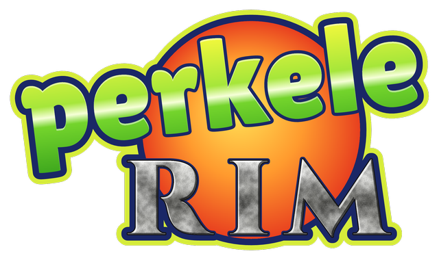
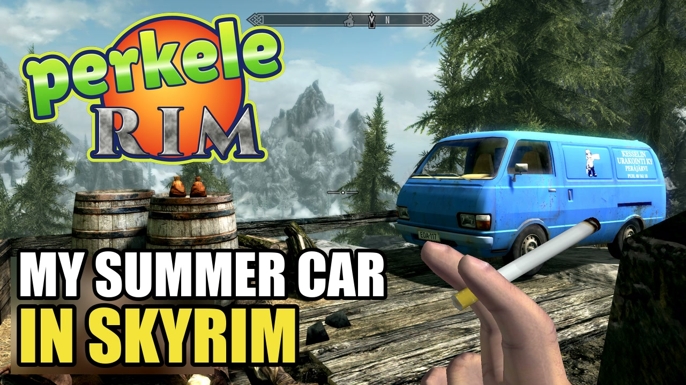
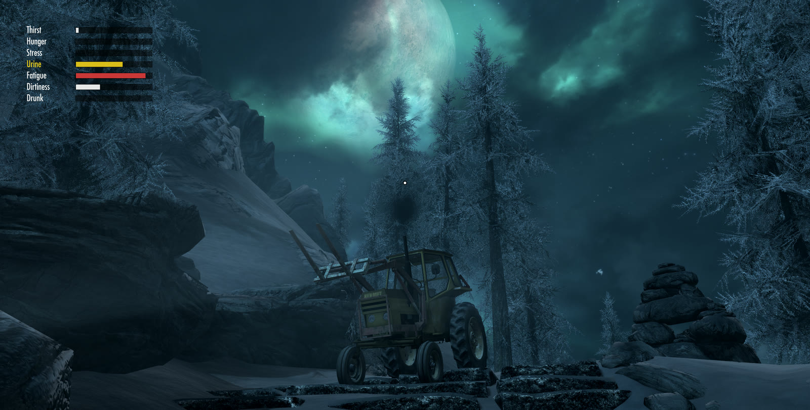
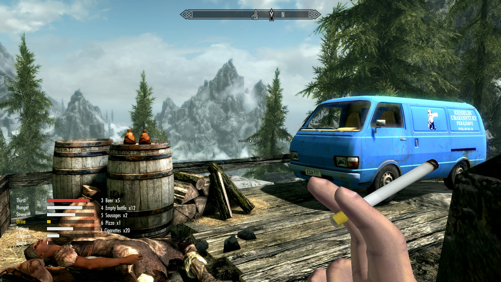
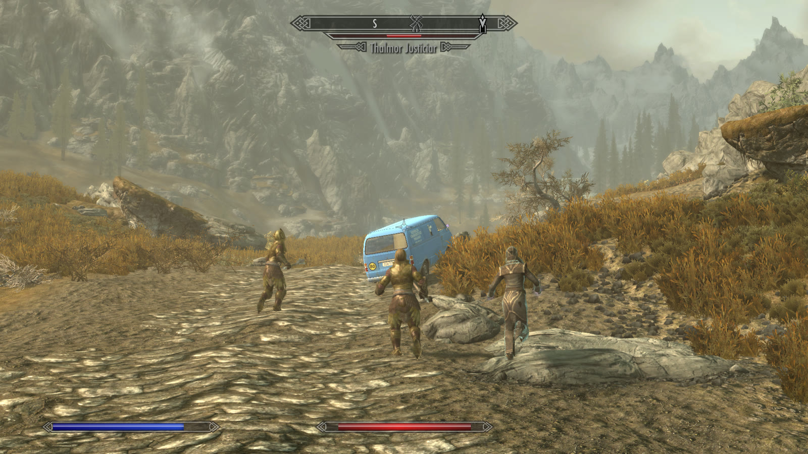
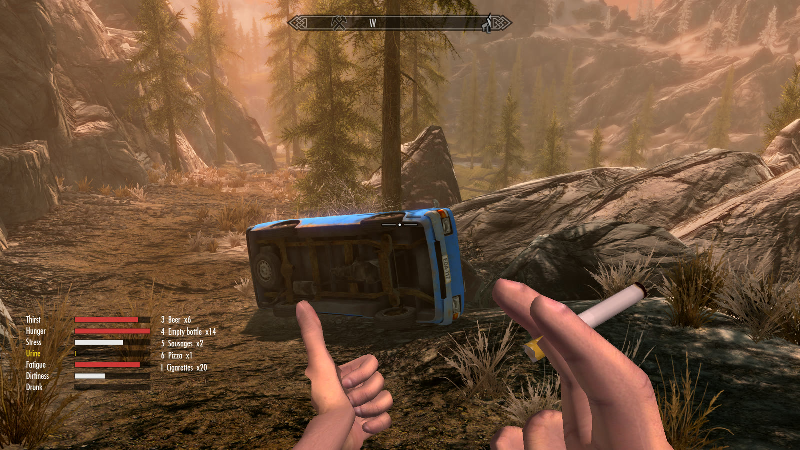
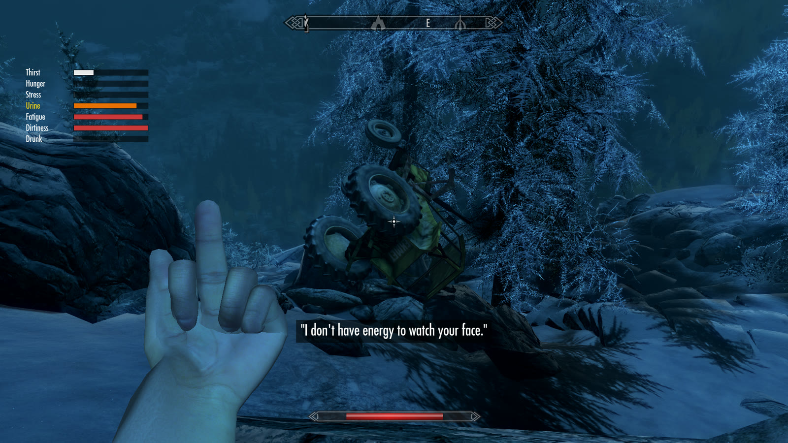

  

  <b>Fus-Perkele-Dah!</b> A Finnish summer in Skyrim. 
  <a href="https://github.com/rackmarten/PerkeleRim/releases/latest"><b>Download</b></a> ·
  <a href="https://discord.gg/C687NV4dCp"><b>Discord</b></a> ·
  <a href="#reporting-bugs"><b>Report a bug</b></a> ·
  <a href="https://ko-fi.com/rackmarten"><b>Buy Kumpo a beer</b></a>

   
  ▶ Watch the trailer on YouTube

**My Summer Car** and **Skyrim (Special or Anniversary Edition)** run at the same time. Skyrim owns the world and draws everything; My Summer Car runs hidden and simulates Kumpo, the vehicles, the beer and the piss. Drive the Hayosiko van across the Whiterun tundra, get drunk, punch a Thalmor, and take the Kekmet tractor up the Throat of the World.

**v0.1.1.** It's playable start to finish, but it's young: expect bugs, and please [report them](#reporting-bugs).

## Install and play

You need:

- Windows 10/11 and a PC that can run both games at once
- [The Elder Scrolls V: Skyrim Special Edition or Anniversary Edition](https://store.steampowered.com/app/489830/) (latest Steam version, or Special Edition 1.5.97) with [SKSE64](https://skse.silverlock.org) for that version and [Address Library for SKSE Plugins](https://www.nexusmods.com/skyrimspecialedition/mods/32444) (the "Special Edition" file on 1.5.97, "All in one (Anniversary Edition)" otherwise)
- [My Summer Car](https://store.steampowered.com/app/516750/) (Steam) with [MSCLoader](https://www.nexusmods.com/mysummercar/mods/147)

Then:

1. Download `PerkeleRim-<version>.zip` from [Releases](https://github.com/rackmarten/PerkeleRim/releases/latest) and extract it anywhere (not inside a game folder).
2. Double-click **Start PerkeleRim.bat**. The first time, a short setup finds both games (or lets you pick their folders), checks for MSCLoader, SKSE and Address Library and opens the download pages of anything missing, and waits while you install it. Then, and every time after, it installs or updates the mod and starts both games (My Summer Car minimizes itself). No mod manager needed.
3. Play in Skyrim only. Load the **PerkeleRim-Kumpo** save (Anniversary Edition only) or one of your own, and Kumpo goes over to My Summer Car by himself once it has loaded. Or start a new game: Kumpo drinks one beer too many in My Summer Car and wakes up in the Helgen cart, and goes over once he's out of Helgen. Leave MSC minimized.

What Start PerkeleRim.bat does, in detail

Every time you run it, it:

- the first time, finds both games in your Steam libraries (a library on a drive that's gone is skipped) and asks you to confirm them, or to pick their folders (saved in `PerkeleRim.ini` next to it; delete that file to run setup again),
- tells you if SKSE, Address Library or MSCLoader is missing (or is for another Skyrim version) and offers to open their download pages,
- installs or updates the mod (the SKSE plugin and `PerkeleRim.esp` in Skyrim, enabled in `plugins.txt`; the MSCLoader mod where MSCLoader keeps mods),
- gives My Summer Car a starter save (needs reset to fresh) when you have none, never over yours,
- adds a starter Skyrim save, **PerkeleRim-Kumpo** (a male Nord just out of Helgen, never handed over yet), next to your own saves, never over one (Anniversary Edition only: Special Edition 1.5.97 can't load it),
- starts My Summer Car in a small window that minimizes itself and continues your MSC save, then starts Skyrim through SKSE,
- puts My Summer Car's own resolution and quality back once MSC closes, so MSC started from Steam afterwards looks as you set it up.

With **Mod Organizer 2** managing your Skyrim, setup asks once whether to start Skyrim through MO2 (`ModManager=MO2` in `PerkeleRim.ini`). Then your MO2 mods load too, Address Library may be an MO2 mod, PerkeleRim's Skyrim files still go in Skyrim's own Data folder (MO2 shows them to Skyrim) and `PerkeleRim.esp` is ticked in MO2's selected profile (while MO2 is open, the launcher asks you to tick it there). If an older PerkeleRim is an MO2 mod as well, the launcher tells you to untick it, since MO2 would load that one instead. Vortex needs nothing special.

Tip: playing your own character? Make him a male Nord, like the starter save's Kumpo. While MSC has the player, Skyrim's own voice is muted and Kumpo Kempolaari (Finn) does the yelling, grunting and swearing, so a Nord fits best whenever Skyrim has the player back.

<table>
  <tr>
    <td></td>
    <td></td>
  </tr>
  <tr>
    <td></td>
    <td></td>
  </tr>
</table>

## Keys

Loading a save hands the player to My Summer Car by itself; if MSC isn't running, Skyrim says so and Kumpo goes over once it is. F10 takes him back to Skyrim and hands him over again (handy for debugging). While MSC has the player you never need its window: WASD and the mouse are MSC's, Skyrim keeps Escape (pauses both games), Tab, M (map), F5/F9 and the console, and MSC's hand actions sit next to WASD:

| Key | Action |
|---|---|
| Left / right click (free hands) | punch / guard (Skyrim blocks) |
| V | middle finger (a guard or Jarl close by in front adds a 5 gold bounty) |
| Z | Skyrim's shout or power, as usual, but Kumpo yells it (Unrelenting Force: "PER", "PER-KE", "PER-KE-LE!" by words; other shouts a Finnish word) |
| Alt (tap) | piss: a quick tap starts it and Kumpo goes until he is empty (Alt+Tab doesn't start it) |
| Middle click | swear |
| C / B | smoke / zoom |
| Ctrl / G (on foot) | crouch / push stance on / off (walk into people to shove them aside; rights a rolled van) |
| O | hitchhike thumb |
| T (on foot) | Skyrim's Wait menu: Kumpo waits or sleeps, MSC's clock and needs go along (8 hours in a bed take fatigue to 0, waiting without one rests slower) |
| Shift / Ctrl (driving) | shift up / down |
| H (driving) | horn: people in the way run off |
| F8 (driving) | chase camera for filming, on / off (hides the HUD) |
| F11 | screenshot of both games, to Screenshots next to Start PerkeleRim.bat |
| [ / ] / ; (on foot) | call the Jonnez moped / the Hayosiko van / the Kekmet tractor: it's parked in front of you, wherever it was |
| Y | puts what Kumpo carries (or looks at) into Skyrim's inventory |
| 1 to 8 | Skyrim's favorites hotkeys: at first 1 hands, 2 tools, 3 an empty bottle to throw, 4 MSC Beer, 5 to 8 MSC's food; rebind them, or any Skyrim food and drink, in Skyrim's Favorites menu (R on foot) |

Driving, G and T are MSC's shift up and boost, X its clutch. MSC's own keys (N, P, O, J, I, ...) still work. Full table for both games: [docs/PROTOCOL.md, Input](docs/PROTOCOL.md#input).

Kumpo eats and drinks Skyrim's food: it feeds his MSC hunger and thirst, and Skyrim's ale, mead, wine and Skooma get him drunk (a bottle leaves an empty one to throw). Skyrim's gold is his MSC money, both ways.

His needs count past the red mark: starving or thirsty past 150 drains health and kills, tired slows stamina regen, stressed punches harder, a full bladder slows him down and dirty Kumpo pays more at traders. His hands shake the longer he's been dry; a beer or two steadies them.

Kumpo fights with his fists: weapons and spells can't be equipped while MSC has the player, armor works as usual, and the drunker he is, the harder he hits and the more he can take. A punch also cuts spider webs and breaks destructibles in front of him (oil pots, barricades), and so does a thrown bottle that hits one. A throw from sneak at someone who hasn't noticed Kumpo is a sneak attack for double damage. Sitting in the Hayosiko van or the Kekmet is safe: nothing in Skyrim can hurt Kumpo there (the moped is no shelter, and a crash still hurts).

## Known issues

- Followers get in the way and are easy to run over. We don't recommend taking one along in v0.1.
- Horses don't work properly, so don't ride them. Kumpo is a drunk, not a horse rider.
- Water is mostly ignored: Kumpo walks on the bottom, Skyrim can drown him and vehicles drive through water. Wading in up to the waist washes him (dirtiness to 0), but there is no thirst from water.
- Vehicles are solid in Skyrim only while they stand or crawl: parked, they stop arrows and spells and people walk around them, but from about 7 km/h they leave Skyrim's world so MSC can run people over, and arrows fly through them again. Melee and blasts can still reach Kumpo over the van's roof: Skyrim's body of him stands at full height in the seat. Kumpo is safe inside the van and the Kekmet anyway.

## Roadmap

No dates, just intentions. What comes next depends a lot on what people enjoy, so tell us in `#perkelerim-ideas` on [Discord](https://discord.gg/C687NV4dCp).

**Next**

- **The Satsuma** on the Whiterun tundra, next to the van, moped and Kekmet.
- **Water and swimming**: swim instead of walking on the bottom, drink from lakes and rivers for thirst, and vehicles that don't just drive through water.

**Later, maybe**

- The Gifu truck, delivery jobs and traffic.
- More Finnish summer: clear weather, long bright evenings, a sauna by the garage.

**Not planned**

- Multiplayer of any kind.
- Shipping any assets from My Summer Car or Skyrim (see [Game assets](#game-assets)).

## Reporting bugs

Double-click **Report a bug.bat** (next to Start PerkeleRim.bat). It puts `PerkeleRim-bug-<date>.zip` in the `Bug reports` folder next to the launcher, with your PerkeleRim logs from both games, `PerkeleRim.ini` and the game versions (your Windows user name is replaced by `%USERPROFILE%`), then opens the bug form on GitHub with the versions filled in. Say what happened and drag the zip into the form. Nothing is sent anywhere until you submit it, and PerkeleRim has no telemetry of any kind.

Questions, screenshots, or just want to tell us how far up the mountain the tractor got? Come say hi on [Discord](https://discord.gg/C687NV4dCp).

## How it works

- An **SKSE plugin** (C++) samples Skyrim's collision around the player, mirrors NPCs, and renders the My Summer Car player, vehicles and items inside Skyrim.
- An **MSCLoader mod** (C#) builds that collision inside My Summer Car, runs the player and vehicle physics on it, and streams poses and events back.
- The two talk over versioned shared memory.

Details: [docs/DESIGN.md](docs/DESIGN.md) and [docs/PROTOCOL.md](docs/PROTOCOL.md). To build from source, see [docs/DEV_SETUP.md](docs/DEV_SETUP.md); `scripts/package.ps1` builds the release zip.

Inspired by [SkyCraft](https://github.com/chasmlol/SkyCraft), which couples Minecraft and Skyrim the same way.

## Repository layout

| Path | Contents |
|---|---|
| [`docs/`](docs/) | Design and protocol documentation |
| [`protocol/`](protocol/) | Shared, versioned message layout (C header, mirrored in C#) |
| [`skse/`](skse/) | SKSE plugin (C++) |
| [`msc/`](msc/) | MSCLoader mod (C#) |
| [`skyrim-data/`](skyrim-data/) | Skyrim plugin (ESP), garage, scripts |
| [`tools/`](tools/) | ESP generator, optional dev tools (offline van NIF conversion) and debugging helpers |
| [`launcher/`](launcher/) | Player launcher shipped in the release zip, starter saves (`launcher/saves/`) |
| [`scripts/`](scripts/) | Build, local deploy, packaging and log scripts (PowerShell) |

## Game assets

This repository contains **no assets from My Summer Car or Skyrim**, and contributions must not add any. You need your own copies of both games. Skyrim draws MSC's van and items from MSC's own models, read from your running game at play time, so nothing is converted or installed beyond the release zip. See [CONTRIBUTING.md](CONTRIBUTING.md#game-assets).

## Contributing

Contributions are welcome. Read [CONTRIBUTING.md](CONTRIBUTING.md) and the [Code of Conduct](CODE_OF_CONDUCT.md) first, and open an issue before starting anything big.

## License

[MIT](LICENSE) © Marek Uncik ([rackmarten](https://github.com/rackmarten)), except [`tools/esp-gen/`](tools/esp-gen/), a build-time tool that uses the GPL-3.0 Mutagen library and is GPL-3.0 itself ([its LICENSE](tools/esp-gen/LICENSE)). The ESP it generates contains no code from it.

Not affiliated with or endorsed by Amistech Games or Bethesda Softworks. My Summer Car and Skyrim are trademarks of their respective owners.
